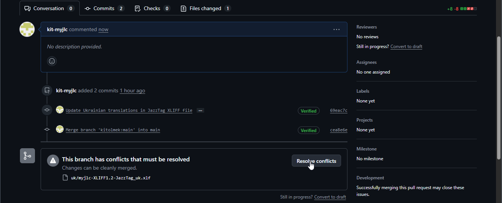
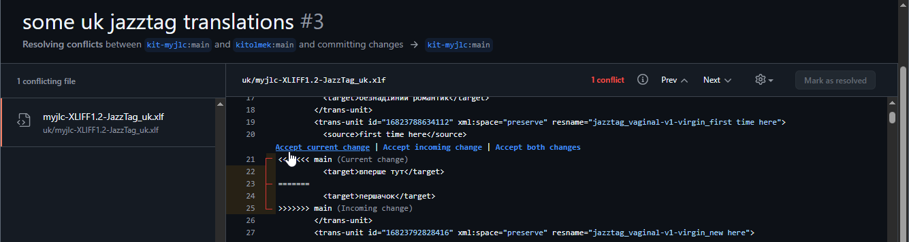
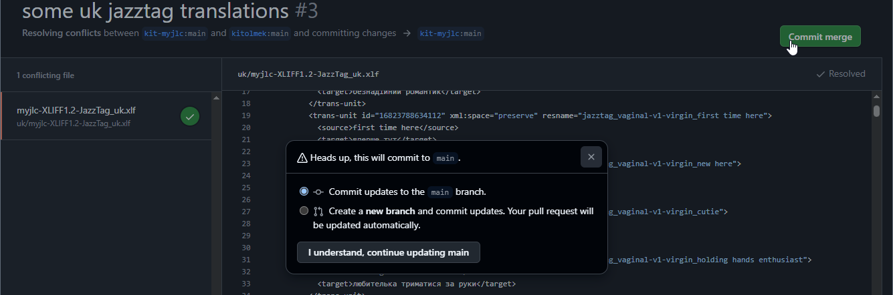

# myjlc-locale

This repository contains the localization text lines for the adult game "My Jazzy Lolly Crush". We don't want to translate the game using AI or automated translators, so we're inviting our players to take a part in adapting the game to their language.


# Data format

The text lines are dumped in XLIFF format v1.2, which is common for game localizations. It is XML-based text format and theoretically you can open it in *any* text editor to make changes. You can even apply small changes using the github built-in text editor with minimal efforts. Though, I suggest using a specialized software to open and edit the files. 

The best editor I tested is [xliff.ai](https://xliff.ai/editor/), which is an online tool, so you don't need to install anything for work. The main selling point (as for me) is that it allows you to see not only the original text but also the line keys, which are all manually defined by me and might help a lot providing more context about where the text line is used. Also it includes some automated quality checks, allows to create a glossary and to connect AI tools, which are not necessary but pleasant bonus features for those who translate things professionally.


# Structure

Each folder contains the lines for a certain language. The files inside represent different scopes:

- `myjlc-XLIFF1.2-Help_xx.xlf` -- for the 'bubble' tooltips are shown in the game help and welcome screen.
- `myjlc-XLIFF1.2-JazzTag_xx.xlf` -- for the 'tags' generated in the girl's Jazz profile, representing the traits. That's where original keys come in handy -- those contain the actual trait ids (not UI names, but ids) providing more context for translation.
- `myjlc-XLIFF1.2-NamePool_xx.xlf` -- potential names for girls. This is the largest subset and it doesn't need an actual translation (I'd like to keep the original cultural context for most of the names), only transliteration into your language. Keys here contain the culture where the name belongs to.
- `myjlc-XLIFF1.2-Trait_xx.xlf` -- girl traits: names and descriptive tooltips. Keys contain the in-game trait ids, so this can be used to match JazzTags with the familiar trait names.
- `myjlc-XLIFF1.2-TrustMod_xx.xlf` -- trust modifiers for Jazz mode.
- `myjlc-XLIFF1.2-UI_xx.xlf` -- for static UI labels. This is the largest actually translatable subset. Keys contain the game area where the label is used: like 'main' for main UI you see all the time while playing, 'settings' for settings window, 'wizard' for sandbox constructor window etc. 'btn' code is used for button tooltips, 'hint' for large labels' tooltips. It's difficult to explain the whole key structure here, but I tried to make it as verbose as possible.
- `myjlc-XLIFF1.2-Wardrobe_xx.xlf` -- wardrobe item names (this includes toys). 'group_xx" for clothes categories, 'unlock_xx' for the groups unlockable in Jazz mode (these are shown in log and confirmation dialog).


# Glossary

- *Version control system* (VCS) -- software allowing many people to work with the same files with minimal conflicts.
- *Git* -- the most popular version control system in the world. Github is its most popular web implementation, allowing millions of people to work together.
- *Repository* -- literally a collection of files, which are managed by version control system. It's program code usually, but simple text files in our case.
- *Fork* -- your own copy of main *repository*. The idea is that you make whatever you want with your fork, and when you're happy with the changes you suggest them back to the owner of main repository. Also a verb meaning 'to make a fork'
- *Commit* -- literally a set of changes. Usually you make multiple changes on your local computer, then commit them to make version control system know about them. In our case you'll probably use the github UI, so it will handle each file edit as a single commit -- that's ok, we can live with it. Also the verb meaning 'to create a commit'.
- *Pull request* (PR) -- the request to the repository owner to accept your changes. They can just accept it 'as is' or leave you a feedback.
- *Conflict* -- the line changed by multiple persons in parallel. Version control system is designed to merge most changes automatically until the parallel changes are done in the very same place. Then it shows it as a conflict and require human intrusion to help her.


# Workflow

You'll need the github account to participate. Note, if you worry about your privacy and do not want to share your everyday name/nickname, consider creating a separate account for this.

## Fork the repository

It's a bad idea for everyone to write changes into the main codebase, so the most common approach is that you make your own copy, apply changes to it and, when you're happy with the result, suggest your changes to the author.


You can name your copy as you wish. Check 'copy main branch only' if it's unchecked.

## Make changes directly

Now you can navigate to the file(s) you're going to work with in the browser. Github provides a basic text editor which is enough for our purpose if you're not afraid of editing XML files directly.

Navigate to the wanted file and click the 'edit icon' in the right-top corner. 


Note, if you're making changes like this, the 'scary code-like framing' should be left as it is. Each text chunk has the next format:

```
<trans-unit id="12443138293760" xml:space="preserve" resname="trait_name_anal-a2-inexp">
    <source>rookie</source>
    <target>новачок</target>
</trans-unit>
```

Field `resname="XXX"` represents the key I mentioned earlier. It contains the context usually and helps to understand what piece you're looking at.
`<source>YYY</source>` is the original English text for the reference. 
`<target>ZZZ</target>` is the translation. You should change only what's in between the 'target' tags.

So make your changes and save it (the button is at the same corner). Github will ask you for a commit message -- write something describing the changes: like 'translated 10 traits' or 'fixed a typo'. 


Note, it suggests you to choose between commiting to the XX branch (usually 'main') and creating a new one. Simply leave the first option selected to make things easier.

'Commit' itself is literally a pack of changes done, it might include many changes in different files, but when applying changes this way a separate commit is created for each file. That's the main feature of source control systems like git (and github being a face of it): instead of storing whole files it actually stores the changes, so it's much easier for many people to work on the same files. Imagine, Peter changed line 3 of a file, Mike added a few lines after line 9, then Barabara removed the line 111 from the same file -- it might be a problem to combine their work as we now have 3 versions of the same file, but for git these are separate changes and those don't intersect at all.

## Make changes in xliff editor

Alternatively you can download the needed file and make changes in the editor you like.


Open [xliff.ai](https://xliff.ai/editor/), upload the file and it will be opened in a nicer format. The whole structure will be now shown as a table. Most editors show only 'source' and 'target' parts, but the xliff.aihas the nice 'details' button showing the key.


Also it has some minimal quality control checks. In my case it shows warnings about the translation being the same as the original text (yet I needed something for code testing but empty strings).


After you're done save the result with either 'save' or 'export' button. This will download the updated file to your computer. Now you can upload the updated file back to github, it will replace the original one (don't forget to navigate to the wanted folder first, as I did when testing this flow). Add a 'commit message' describing the update, the same as in 'Make changes directly'.


## Make a pull request

After all your changes are ready you should create a 'pull request' to transfer them to the main repository. Then someone responsible will get a notification, so they could re-check your changes and approve it. Or deny the update and add some comments explaining what's wrong (for example, the structure is broken or someone else translated this part in parallel and we need to choose the best option now).


If you need to fix something, you don't need to crerate new pool requests. All changes you commit on top will be automatically added. Then after your request is approved and merged into the main repository it's closed and you'll have a create new ones for next pieces.

## Best practices

To keep your copy up-to-date with everyone it's a good idea to sync it with the main repository before starting a work session, so you can get all the changes made by other translators and not duplicate their work.


Make 'commits' at the end of each work session to save your work, e.g. once a day. Once a meaningful amount of changes is collected, make pull requests to push them to the main repository as it was described above. 

You're not required to push your changes every day (I'm afraid to spend all my time reviewing your changes, honestly), though don't keep your updates private for too long as well. Otherwise if there are multiple translators for your language there might occur conflicts. It's not a big deal actually, as git is designed to resolve issues like this, I'm going to cover it in the next part.

## Conflicts

If someone else eedited the same lines as you do a conflict might appear. Then you'll get a warning about that when creating a pull request -- proceed and you'll get an opportunity to fix it. Click 'resolve conflicts' in your pull requests and you'll get a view showing you conflict lines.



For each conflict you'll see 2 options: 'current change' is your suggestion and 'incoming change' is the one who someone already uploaded. Click the relevant link to accept the better option (but not both, as it will break the file format). After all conflicts are fixed click the right-top button 'mark as resolved'



When the conflicts in all files are fixed, commit your 'patch'. You might get a warning about it, don't worry, just proceed and now your pull request can be easily accepted.




# Outro

It feels weird writing a guide like this for people who never used git and github earlier. Though I tried to explain things in detail and with screenshots -- I hope it will help. This guide will be extended if necessary. Feel free to ask questions in our discord if something's not clear.

Thank you for your help!
